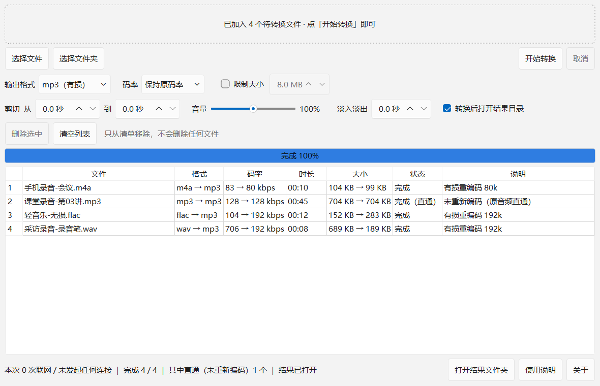

# 音频格式转换工具

拖进来选个格式，转完就在原文件旁边。

面向 Windows 10 / 11 的本地音频转换工具：mp3、wav、flac、m4a、ogg 互转，能剪时间段、调音量、加淡入淡出，还能直接把视频里的音轨抽出来。全程调用随包的 ffmpeg，**不联网、不上传、不覆盖原文件**。



## 能做什么

- **格式互转**：输入 mp3 / wav / flac / m4a / aac / ogg / wma / ape / opus / aiff；输出 mp3 / m4a / ogg（有损）与 flac / wav（无损）
- **视频取音轨**：mp4 / mkv / mov / avi / flv / webm / ts 等拖进来，自动只取第 1 条音轨
- **码率预设**：保持原码率（默认）/ 320k / 192k / 128k / 64k，仅对 mp3 / m4a / ogg 生效
- **限制大小**：勾选后填一个 MB 上限，码率按「目标体积 ÷ 时长」自动反推，转完复称体积，略超会自动降一档重编一次
- **「保持原码率」不会把文件转胖**：ogg / Vorbis 这类可变码率文件的标称码率常虚高（标称 500k、实际 108k），程序按体积反推的平均值输出，最多 192k
- **剪切**：按秒填起始与结束（结束填 0 = 到最后），越界会给出可读提示，不静默截断
- **音量 0%–200%**、**淡入淡出**（0 = 关），音频太短时淡入淡出会自动收小并说明
- **批量**：文件或整个文件夹拖进来，递归查找（自动跳过已生成的 `out`）
- **逐条报告**：结果表与双击详情写清「有没有重新编码、码率从多少变到多少」，并写出 `report.json`
- **命令行**：同一套引擎，可脚本化批量转换

## 快速开始（源码运行）

```powershell
python -m pip install -r requirements.txt
python -B main.py
```

或者双击 `run.bat`（依次找 `venv`、`py` 启动器、PATH 上的 `python`，都会先试 `import PySide6`）。

> 需要 Python 3.10+ 与 PySide6。ffmpeg 已随仓库放在 `ffmpeg\bin`，不需要另外安装。

如果 Python 装在非常规位置（`python` 命令不可用），先指定解释器再运行：

```powershell
set PYTHON=D:\Apps\Python310\python.exe
run.bat
```

## 命令行

```powershell
python cli.py --to wav 录音.mp3
python cli.py --to mp3 --bitrate 192k .\音乐
python cli.py --to flac --start 30 --end 90 a.mp3 b.wav
python cli.py --to mp3 --gain 150 --fade 2 .\素材
python cli.py --version
```

打包后的写法：`音频格式转换工具.exe --cli --to mp3 --bitrate 192k 文件...`

## 结果在哪

- 每个文件的结果写在**它自己旁边的 `out` 文件夹**里，例如 `音乐\out\歌声.mp3`
- 同名结果自动加序号（`歌声 (1).mp3`），**绝不覆盖**已有文件
- 原文件只读不写：每次处理前后都会比对 SHA-256，并把结果写进报告
- `out\report.json` 里有逐条的格式、码率、采样率、声道、时长、是否重编码、耗时与结果路径

## 关于「无损」的说明

不写「无损转换」四个字。mp3 / m4a / ogg 是有损格式，**转进去就是重新压缩**，高频细节会减少，码率越低越明显；flac / wav 之间互转不会产生新的损失。
只有「源编码与目标编码一致、且没有剪切 / 调音量 / 淡入淡出」时才走直通（`-c copy`，未重新编码），此时音质与原文件一致。

## 已知限制

- 不做多文件合并（v1.1 再议）
- 不做波形可视化剪辑，只按秒数切
- 不做变声 / 变调 / 降噪 / 响度标准化
- 不做 CD 抓轨；有版权保护的内容（`.m4p` 等）会直接提示「本工具不处理」
- 不做视频画面处理（要剪视频请用视频压缩工具）
- 不做 GPU 加速（音频编码本来就快，没有意义）
- `.wma` / `.ape` 只能读不能写，所以不在输出格式里

## 自测

```powershell
python -B verify.py          # 引擎验收，33 项断言
python -B tools\ui_test.py   # 界面自检，62 项断言（offscreen 跑）
python -B main.py --selftest # 无界面自检，验证随包 ffmpeg 能编码 / 能直通
```

`verify.py` 会用随包 ffmpeg 现场合成素材（正弦波、带音轨/无音轨视频、损坏文件），不依赖外部文件。

## 打包

```powershell
build_exe.bat        # PyInstaller onedir → dist\音频格式转换工具\
build_installer.bat  # Inno Setup → dist\安装包\音频格式转换工具-1.0.0-安装包.exe
```

安装包按当前用户安装（`PrivilegesRequired=lowest`），不请求管理员权限、不弹 UAC；卸载不留残留。ffmpeg 整份随包分发，用户机器上不需要预装。

打包后建议再跑一遍：

```powershell
dist\音频格式转换工具\音频格式转换工具.exe --selftest
```

## 目录结构

```
音频格式转换工具\
├── main.py          界面（PySide6）+ Worker 线程
├── cli.py           命令行
├── verify.py        引擎验收（33 项）
├── core\
│   ├── about.py         应用名 / 版本 / 公司 / 使用说明文案
│   ├── compliance.py    NetworkAudit（0 联网自检）
│   ├── ffmpeg_tool.py   ffmpeg 定位、探测、调用、报错翻译
│   └── audio_job.py     转换核心与逐条报告
├── ffmpeg\bin       ffmpeg / ffprobe + 依赖 DLL（随包分发）
├── resources\       图标
├── docs\            产品介绍、界面截图
├── 教程MD\          官网用教程
└── tools\           图标、截图、界面自检、打包版本资源
```

## 隐私

本工具不发起任何网络连接：转换、界面、CLI 全走本地进程。底部常驻「本次 0 次联网」由 `NetworkAudit` 实测，打包后的 `--selftest` 也会断言这一点。

更多免费软件：https://www.mrheedu.com

## 仓库说明

本仓库只包含源码，以下运行时资源体积较大，未纳入仓库：

- ffmpeg/（FFmpeg 运行时）：自行下载 FFmpeg 后放到该目录再运行/打包。
